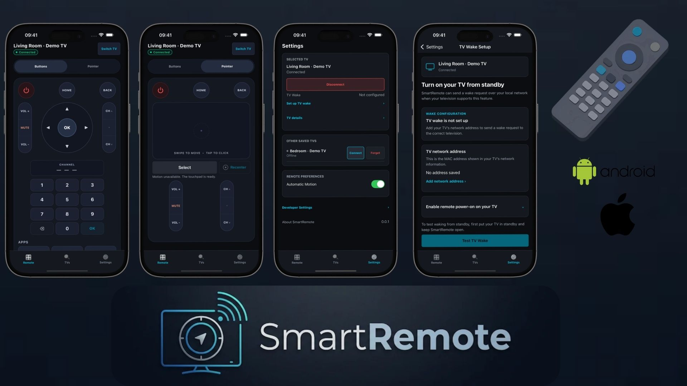

# SmartRemote

### Cross-Platform Smart TV Remote Control Application

SmartRemote is a cross-platform mobile application developed with **React Native and TypeScript**, integrating native iOS and Android capabilities to control compatible LG webOS televisions over a local network.

The project combines a Clean Architecture-inspired layered architecture, the Adapter Pattern, native platform integrations, and secure WebSocket transport to separate shared mobile behavior from LG-specific communication.

Although the current implementation focuses on LG webOS, the software architecture is designed to support additional television manufacturers through manufacturer-specific adapters.

---

## Application Preview



This showcase is a visual representation of SmartRemote. Demo TV Connected status does not demonstrate a physical TV connection, physical-device testing, app store availability, or support beyond compatible LG webOS televisions. Android and connection recovery captures are documented in the [screenshot report](docs/PHASE_15_UI_POLISH_AND_SCREENSHOTS.md); Settings and TV Wake Setup captures are documented in the [TV Wake Setup report](docs/PHASE_15_1_TV_WAKE_SETUP.md).

---

## Technology Stack

| Category | Technologies |
|---|---|
| Mobile Development | React Native, TypeScript |
| State Management | Redux Toolkit, React Redux |
| Navigation | React Navigation |
| iOS Native Development | Swift, Objective-C, CoreMotion |
| Android Native Development | Kotlin, SensorManager, OkHttp |
| Network Communication | WebSocket, WSS, SSAP, UDP, SSDP |
| Security | TLS, Certificate Validation, Fingerprint Verification |
| Local Persistence | AsyncStorage, React Native Keychain |
| Architecture | Clean Architecture-inspired layers, Adapter Pattern, Factory Pattern, Dependency Injection |

React Native is responsible for the shared user interface and application logic, while native implementations are used for platform-specific networking and sensor functionality.

---

## 1. Software Architecture

SmartRemote uses a **Clean Architecture-inspired layered architecture**, separating presentation, application logic, domain abstractions, and infrastructure implementations.

The primary objective is to minimize dependencies between components and isolate manufacturer-specific television protocols from the rest of the application.

### Architecture Overview

```text
Primary source dependencies (arrows mean "depends on")

  Presentation --------> Application --------> Domain
       |                                         ^
       +-----------------------------------------+
                                                 |
  Infrastructure --------------------------------+
                 implements domain contracts

  src/di: composes services and concrete implementations
  src/store: Redux state, connected through bindings/hooks
```

### Domain Layer

The Domain layer defines the core models and interfaces of the application independently of UI frameworks and television manufacturers.

It contains abstractions such as `TVDevice`, `TVCapabilities`, `TVConnectionState`, and `ITVRemoteAdapter`.

These models and interfaces establish shared contracts for television operations without depending on LG-specific communication details.

### Application Layer

The Application layer coordinates the application's operations through dedicated use cases.

Examples include `ConnectTVUseCase`, `SendRemoteCommandUseCase`, `RestoreLastTVUseCase`, and `DiscoverTVsUseCase`.

The `TVConnectionManager` manages active television connections, session restoration, reconnection attempts, and connection lifecycle transitions.

### Infrastructure Layer

The Infrastructure layer provides concrete implementations of the domain interfaces.

It includes `LGWebOSAdapter`, WebSocket communication, SSDP discovery, secure credential storage, local persistence, and platform-specific native modules.

### Presentation Layer

The Presentation layer consists of React Native screens, reusable components, custom hooks, navigation, and Redux state integration.

Screens and hooks invoke application use cases and connection services without implementing television protocols. `src/store` holds device, connection, and remote preference state; `src/di` constructs dependencies and binds service events to Redux. The composition root also coordinates store bindings and platform selection.

---

## 2. Design Patterns and Multi-Brand Extensibility

One of SmartRemote's core architectural decisions is the use of the **Adapter Pattern**.

Different Smart TV manufacturers may use different communication protocols, authentication mechanisms, and command structures.

Rather than integrating these differences directly into the UI, SmartRemote defines common interfaces for television communication.

### Adapter Architecture

```text
Resolution at runtime:
  TVConnectionManager
          |
          v
  ITVAdapterFactory -> TVAdapterFactory
                            |
                            +-- resolves/creates -> LGWebOSAdapter
                            +-- future registration -> FutureAdapter
                                                       (planned)

Shared contract:
  LGWebOSAdapter ---- implements ----> ITVRemoteAdapter
  FutureAdapter -- would implement --> ITVRemoteAdapter

Application code uses ITVRemoteAdapter for TV operations.
```

### Adapter Pattern

`LGWebOSAdapter` translates application-level remote commands into LG webOS-specific communication.

This allows the application to execute shared operations without requiring the presentation layer to understand SSAP messages or WebSocket details.

### Factory Pattern and Dependency Injection

`TVAdapterFactory` uses registrations that match both device protocol and TV platform, then creates the concrete adapter. Unmatched devices are rejected rather than inferred from brand alone.

**Dependency Injection** in `src/di/container.ts` supplies implementations of contracts such as `ITVAdapterFactory`, `ITVDeviceRepository`, and `ICredentialStorage` to services and use cases.

Together, these patterns improve modularity, maintainability, and extensibility.

### Extending Support to Other Manufacturers

Future support for another television manufacturer would involve implementing a dedicated adapter for its supported control protocol.

The integration would include device discovery, authentication, command mapping, connection handling, and capability detection.

The shared application logic and React Native interface could continue using the existing abstractions wherever the manufacturer supports equivalent operations.

**Currently supported:** Compatible LG webOS televisions. Additional manufacturers are future extension targets.

---

## 3. LG webOS Communication & Native Networking

SmartRemote communicates with compatible LG webOS televisions using **SSAP (Simple Service Access Protocol)** over WebSocket connections.

While connection management and protocol-level operations are coordinated through TypeScript, the application integrates native networking implementations for secure WebSocket communication on both iOS and Android.

This approach combines the flexibility of React Native with platform-specific control over TLS certificate validation and network transport behavior.

### Connection Architecture

```text
Runtime connection path

  React Native UI -> ConnectTVUseCase -> TVConnectionManager
                                              |
                                              v
                                       LGWebOSAdapter
                                  pairing / SSAP requests
                                              |
                                              v
                                  LGWebOSWebSocketClient
                                              |
                                              v
                                    IWebSocketTransport
                                              |
                         +--------------------+--------------------+
                         |                                        |
                         v                                        v
                 iOS native module                    Android native module
              NSURLSessionWebSocketTask                   Kotlin / OkHttp
              Objective-C trust policy                   TLS trust policy
                         |                                        |
                         +--------------------+--------------------+
                                              |
                                              v
                                         LG webOS TV
```

The diagram shows the native WSS path. Android enforces WSS-only LG connections; the current iOS endpoint list also retains a legacy plaintext WebSocket fallback, so encryption is not guaranteed for every iOS connection.

### Native WebSocket Implementation

React Native provides a WebSocket API; however, LG webOS communication introduces additional requirements related to certificate validation, trusted device identity, and secure connection management.

SmartRemote addresses these requirements through native networking integrations.

**Android — Kotlin & OkHttp**

The Android implementation uses a Kotlin-based native module with OkHttp for WebSocket communication. It manages secure connections, TLS certificate validation, and native connection events, which are exposed to the React Native layer.

**iOS — Objective-C & Native Networking**

The iOS native module uses `NSURLSessionWebSocketTask` with Objective-C networking and security components. On WSS connections, both platforms validate the TV certificate against a bundled LG intermediate CA and check the expected TV certificate identity. TypeScript compares available leaf fingerprints with securely stored device trust records, rejecting certificate changes.

The platform-specific implementations are abstracted behind a shared TypeScript transport interface, allowing the application layer to coordinate communication without depending directly on native networking APIs.

### SSAP Protocol & Pairing

The LG adapter manages the application-level communication required to interact with webOS televisions.

The connection workflow includes:

```text
  SSDP discovery (where supported) / Manual IP
                       |
                       v
         Open WebSocket transport
         WSS: native TLS certificate validation
                       |
                       v
         Check available certificate fingerprint
                       |
                       v
         SSAP registration / TV pairing
                       |
                       v
         Initialize services and capabilities
                       |
                       v
         Dispatch SSAP remote commands
         Pointer input uses a separate socket
```

SSAP command formatting, television pairing coordination, and supported operation handling are implemented within the TypeScript infrastructure layer.

Native modules provide the underlying secure transport, while shared application services manage the overall connection lifecycle.

Pairing keys and certificate fingerprints use `SecureCredentialStorage`, backed by React Native Keychain. Device metadata and remote preferences use AsyncStorage. SSDP discovery uses UDP where available; the current iOS transport disables multicast discovery because it requires a restricted Apple entitlement, so iOS uses manual IP connection.

### Connection Lifecycle & Recovery

The `TVConnectionManager` manages the active television session independently of presentation components.

Its responsibilities include connection restoration, foreground/background lifecycle handling, connection health monitoring, controlled reconnection, and error recovery.

This separation ensures that screens and remote-control components do not directly manage WebSocket sessions or manufacturer-specific networking behavior.

The result is a **cross-platform communication architecture with shared protocol logic and platform-specific secure transport implementations**.

---

## 4. Native Motion and Hybrid Pointer

SmartRemote integrates native motion sensor APIs to support motion-based television pointer control.

While the application interface is developed with React Native, motion sensing relies on native operating system functionality.

### Native Motion Architecture

```text
  iOS: Swift / CoreMotion       Android: Kotlin / SensorManager
              |                              |
              +---------------+--------------+
                              |
                              v
                 React Native module events
                              |
                              v
                   IMotionSensorService
                              |
                              v
                 MotionPointerController
                 filtering / calibration
                              |
                              v
                 useMotionPointer callback
                 gated by useHybridPointer
                              |
                              v
                 SendRemoteCommandUseCase
                              |
                              v
           TVConnectionManager -> LGWebOSAdapter
                              |
                              v
                   LG TV pointer socket
```

### iOS Implementation

The iOS implementation uses **Swift and CoreMotion** to obtain device motion data.

These measurements are provided to the shared application logic and processed into television pointer movements.

### Android Implementation

The Android implementation uses **Kotlin and SensorManager** to collect motion sensor information.

Native sensor functionality is exposed through a React Native integration, allowing the application to share pointer-control behavior across platforms.

### Hybrid Pointer

SmartRemote combines motion-based input and touchpad gestures in a unified Pointer interface.

The user can move the television cursor by physically moving the phone or interacting with the touchpad.

An input coordination mechanism prevents Motion and Touchpad from simultaneously producing conflicting pointer movements.

Motion activity is also managed according to screen navigation, connection state, and foreground/background transitions.

When motion sensors are unavailable, the Pointer interface retains touchpad input.

---

## 5. Platform-Adaptive UI Design

SmartRemote uses a shared React Native UI while applying platform-specific layout and interaction rules for iOS and Android.

Shared theme and layout tokens in `src/presentation/theme` define colors, spacing, content widths, and minimum touch targets. Reusable controls include `DirectionPad`, `VolumeRocker`, `ChannelRocker`, `PointerSurface`, and `NumericKeypad`.

| Design Concern | Implementation |
|---|---|
| Safe areas and cutouts | Safe Area Context supplies top and side insets; navigation owns header and tab regions. |
| Android navigation insets | The tab bar includes the bottom system inset once, avoiding duplicate bottom spacing. |
| Screen density and control sizing | React Native density-independent dimensions combine with window width, available height, and font scale; Android uses denser surfaces while retaining minimum touch targets. |
| Adaptive layout | Width budgets determine when forms, details, and controls stack; content widths are capped on larger displays. |
| Keyboard and scrolling | Settings forms use automatic keyboard insets on iOS; scroll dismissal is interactive on iOS and on-drag on Android, with handled taps for form controls. |

This keeps a shared visual language while accommodating platform layout and interaction differences.

---

## 6. Application Features

SmartRemote currently includes:

- LG webOS remote navigation and media controls
- Volume and channel management
- Direct numeric channel selection
- Secure TV pairing and session management
- Touchpad and motion-based pointer control
- Automatic reconnection and connection restoration
- Saved television management
- SSDP discovery where supported and manual IP connection
- Wake-on-LAN for compatible television configurations
- Connection diagnostics and recovery guidance
- Remote preferences and developer diagnostics

Automated tests cover selected application, communication, UI, and native behavior. Simulator captures validate UI presentation; physical-device checks for pairing, recovery, motion, and standby wake remain necessary, as recorded in the linked validation reports.

---

## 7. Future Development

SmartRemote is designed with extensibility and continued improvement in mind.

**Multi-Brand Integration:** Extend television compatibility by implementing additional manufacturer-specific adapters through the existing architecture.

**Connection Infrastructure:** Improve device rediscovery, network transition handling, diagnostic accuracy, and reconnection reliability.

**Motion Infrastructure:** Further optimize sensor calibration, movement filtering, sensitivity, and pointer stabilization across iOS and Android.

**Platform Experience:** Expand discovery capabilities, improve accessibility, and refine responsive interface behavior across different devices.

---

## Conclusion

SmartRemote brings together **cross-platform mobile development, native iOS and Android integrations, secure local network communication, and modular software architecture**.

Its layered architecture, adapters, factory registrations, and dependency injection separate shared application behavior from manufacturer-specific communication.

By combining React Native with Swift, Objective-C, Kotlin, WebSocket communication, and native motion sensors, SmartRemote provides a practical foundation for developing a maintainable and extensible Smart TV remote control application.

---

*SmartRemote is an independent software development project and is not affiliated with or endorsed by LG Electronics.*